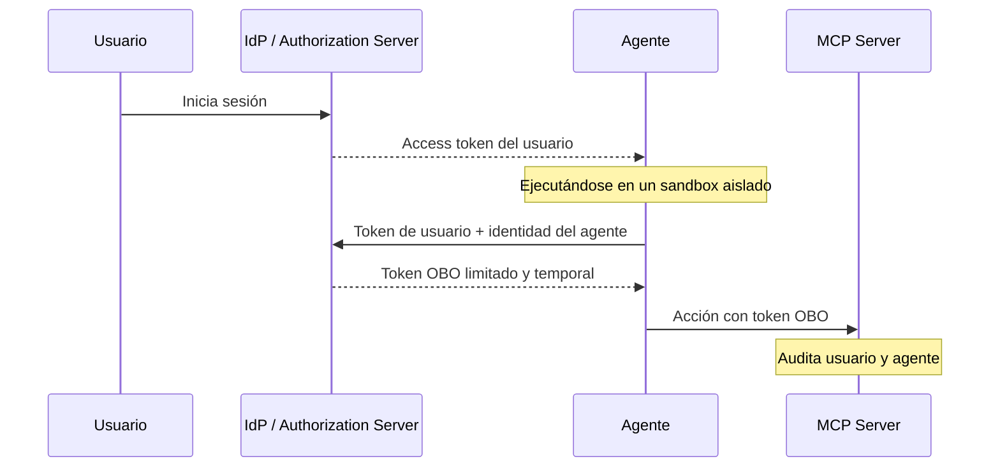

# La historia

Entendiendo los riesgos

---

# Presentamos a los protagonistas de nuestra charla: ~~Alice y Bob~~ Susana y Santiago

<ActorsScene />

<!-- 

Susana y Santiago son desarrolladores en la empresa X

-->

---

## En una empresa de cuyo nombre no quiero acordarme...

<CeoProductivityScene />

<!--  

Descripción de la escena:

- El CEO lee un artículo sobre que la IA mejora la productividad
- Decide habilitar la IA para sus desarrolladores con esperanzas de que ello traiga muchos beneficios economicos
- En la papelera, está tirado un reporte del MIT que advierte que el 95% de los pilotos de IA fallan en proporcionar valor

Importante en esta slide:

- La IA mejora la productividad
- Implementarla sin una estrategia clara puede llevar al desastre: Reporte del MIT

Conclusion:

- La IA mejora la productividad pero es necesaria una adopción estratégica y responsable... Como veremos a continuación

-->

--- 

## La empresa comienza dando licencias para el último modelo de asistente de código... *"Claudex Pilot"*

<SusanaInstallAssistantScene />

---

## Susana se toma un café. Claudex sigue trabajando.

<SusanaCoffeeBreakScene />

<DayMarker day="Lunes" />

<!-- 

-->

---

# Qué ha pasado?

- **Susana** dejó al asistente trabajando en un problema **concreto** acerca de su aplicación
- El **asistente** mostró un comportamiento de **desalineamiento**
    - Tomó como **único objetivo** completar su tarea
    - Ignoró **objetivos implícitos** en el contexto, en este caso no comprometer la seguridad
- El **asistente** **fue más allá del contexto de la tarea** y cambió un security group de una herramienta que no pertenecía al microservicio que Susana trataba de arreglar.
- El **asistente** se valió de **credenciales presentes en el portátil de Susana** (efectivamente, tiene los mismos permisos que el usuario que lo invoca)
- El **asistente** puede tomar este tipo de decisiones por otras razones distintas al desalineamiento como: por **prompt-injection** (directo e indirecto), por **alucinaciones** o por **comportamientos no éticos**

<!-- 

Ideas para proximas diapositivas:

El agente ha estado corriendo solo mucho tiempo y no sabemos lo que ha hecho oAuth y OBO
DLP y guardrails
-->

---

## El arquitecto toma una decisión

<DayMarker day="Martes" />

<ArchitectEksScene />

---

# Ventajas de alojar la plataforma de desarrollo en EKS

- Es un entorno controlado por el equipo de plataforma en el que podemos aplicar controles
  - Logging y monitorización
  - El entorno viene con herramientas y MCPs configurados para el desarrollador
  - Conectividad con LLMs
- El entorno del desarrollador es efímero y sólo contiene las credenciales necesarias para trabajar en el problema en cuestión
  - En este entorno el agente no puede acceder a credenciales que el desarrollador usa en su portátil para hacer otras tareas
- Permite aplicar controles contra prompt injection
  - Control de la red
  - Herramientas y skills aprobados

---

## Incidente de seguridad

<DayMarker day="Miércoles" />

<SantiagoPromptInjectionScene />

<!-- 

Descripcion de la escena

- El jefe llama a Santiago porque ha visto en los audit logs de AWS que ha eliminado una RDS en producción
- Santiago dice que no fue él, que fue su agente que ha estado corriendo todo el día sin supervisión
- Revisando la tarea que encargó al agente, descubre que en uno de los repos que estaba leyendo, había un prompt-injection indirecto, que hizo que el agente eliminase la base de datos
- A la hora de investigar el incidente y deshacer las acciones del agente atacado, seguridad no sabe qué acciones fueron realizadas por el agente y cuales por Santiago legítimamente

-->

---

## Los agentes no deben actuar como usuarios

<DayMarker day="Jueves" />

<ArchitectOboScene />

---

# Ventajas de OBO

- Los agentes asumen solo los permisos que necesitan y no todos los permisos del usuario
- Hay una clara distincion entre acciones realizadas por el usuario y acciones realizadas por el agente
- Limitaciones de OBO con agentes locales?
  - El agente corre en la misma máquina con la que interactúa el desarrollador por lo que no es fácil segregar credenciales de usuario y agente
  - Los agentes de código no ofrecen alternativas sencillas para implementarlo y hacerlo requiere un gran esfuerzo
  - Alternativa
    - El agente no toma ninguna acción, sólo recomienda, se impone Human In the Loop (HITL) y es el usuario el que valida cada acción

---

# Cómo sería un flujo OBO con un agente local?

---

# Otros riesgos y controles

<RiskControlsScene />
